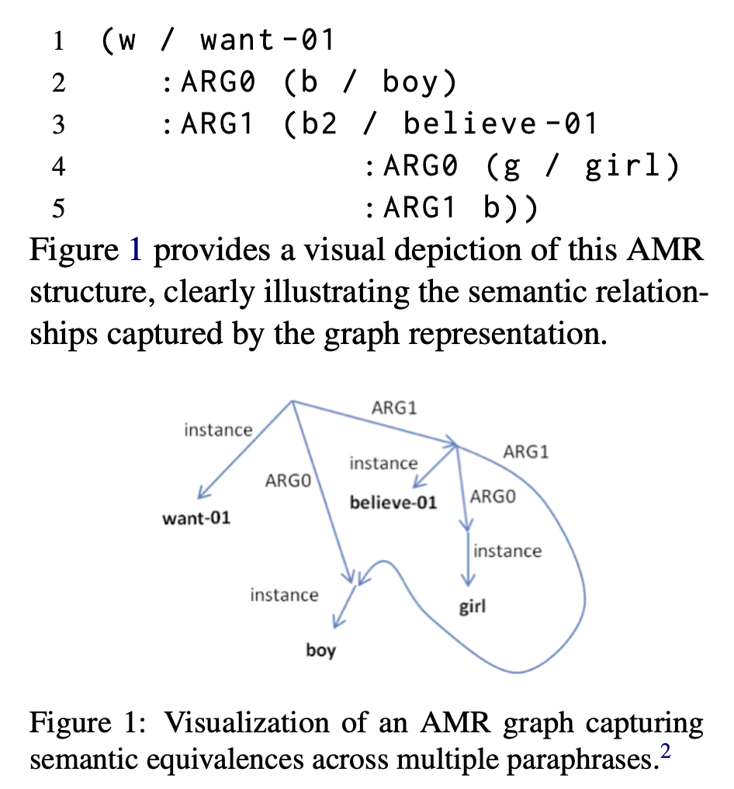
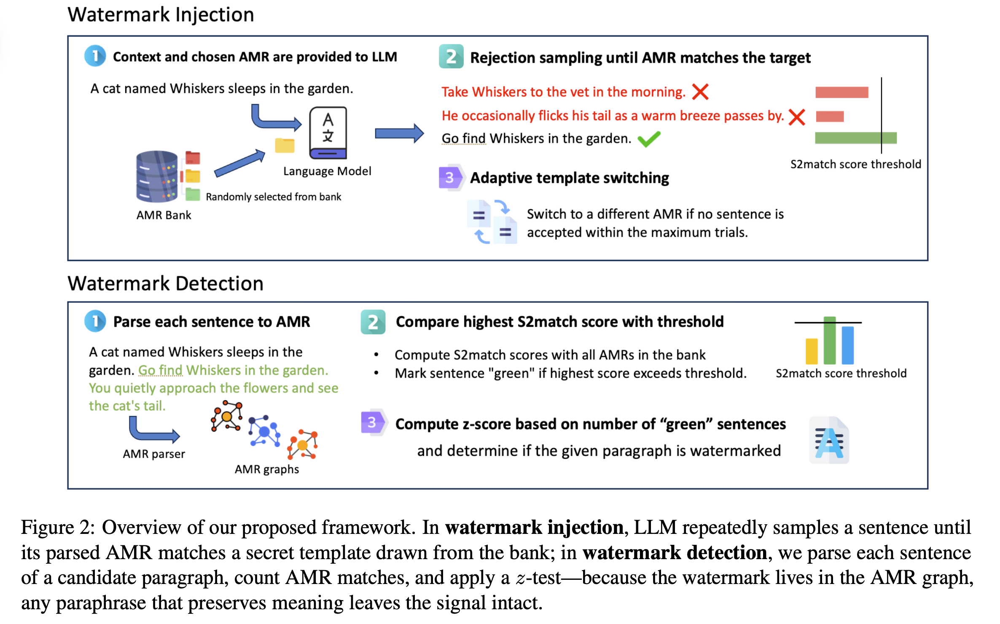
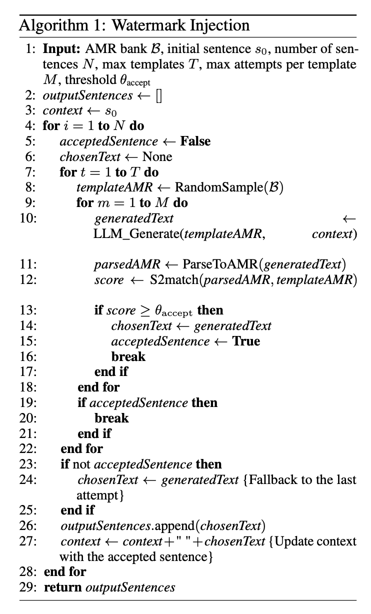
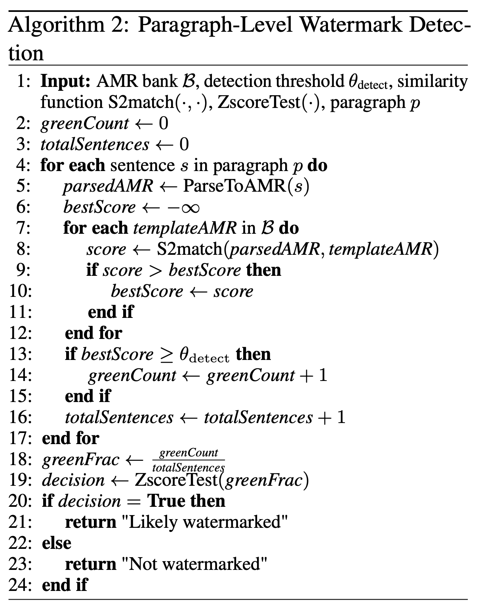
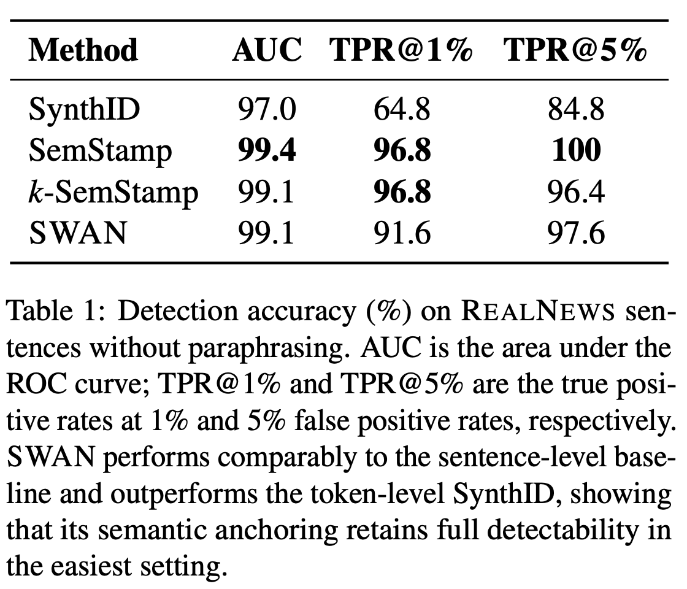
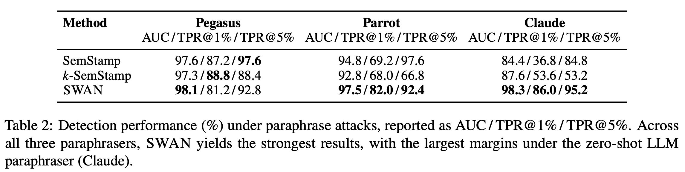
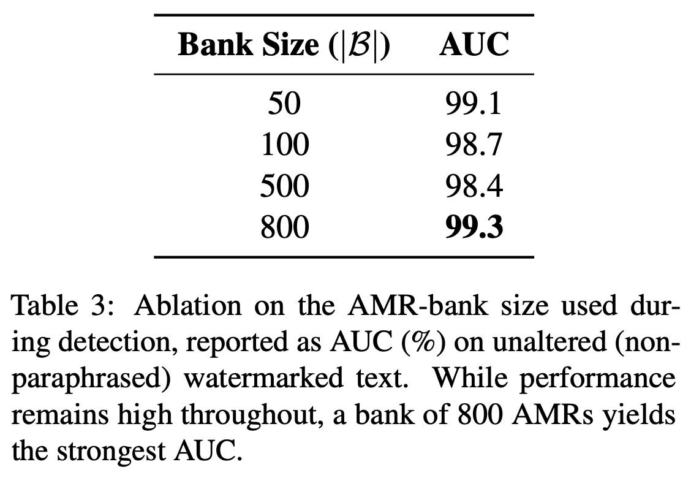
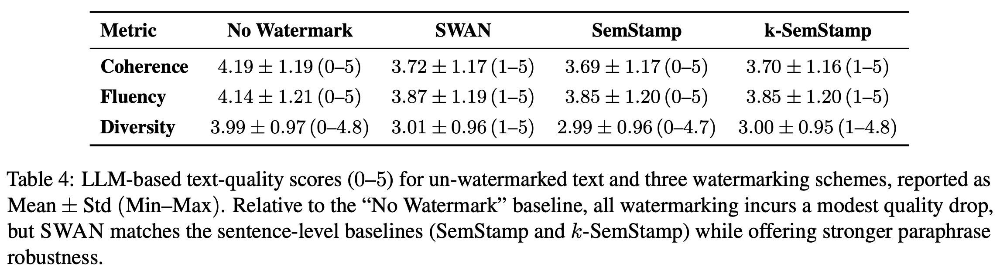
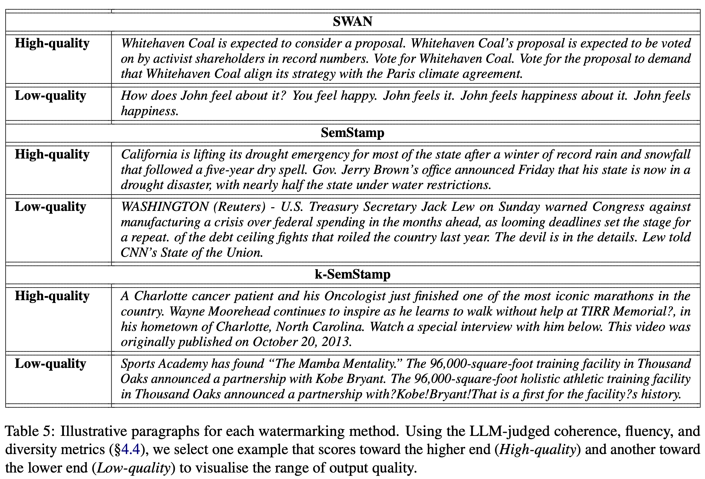
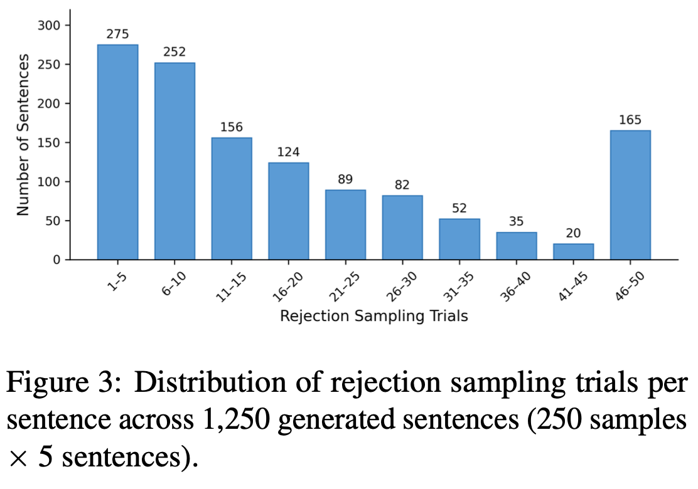

+++
date = '2026-09-22T11:24:16+08:00'
draft = false
title = 'SWAN 論文筆記：Semantic Watermarking with Abstract Meaning Representation'
description = 'ACL 2026 的 SWAN 論文筆記：把浮水印訊號嵌入 AMR 語意結構，透過 AMR template 引導 LLM 生成，藉此抵抗 paraphrasing 攻擊'
image = 'fig2-overview.png'
categories = ['論文筆記']
tags = ['LLM', 'Watermark', 'AMR', 'Semantic Watermark', 'Seminar']
keywords = ['SWAN', 'Semantic Watermarking', 'AMR', 'Abstract Meaning Representation', 'LLM watermark', 'paraphrase attack', '浮水印', '論文筆記']
math = true
+++

# SWAN: Semantic Watermarking with Abstract Meaning Representation

- ACL 2026 main
- 把 watermark 訊號 embed 在 semantic representation，所以相較 token level 的 watermark，這種方法的抗 paraphrasing 能力更好
- 用 prompt (AMR template) llm 的方式來產生具有 semantic watermark 訊號的 text output

> **免責聲明**：這篇是我準備 seminar 報告時整理的個人筆記，主要是幫助自己理解論文，不是嚴謹的論文導讀。內容可能有理解錯誤或不精確的地方，如果發現錯誤歡迎在留言區指正。閱讀時建議搭配[論文原文](https://aclanthology.org/2026.acl-long.1681/)一起看。

現有的 Watermark 方法像是 SynthID-Text (或類似 KGW 的那類 token-level 的方法) 以及 embedding-level 的方法，都很容易受到 paraphrasing 攻擊，就是用另一個 LLM 去改寫原本具有 watermark 訊號的文字，藉此將 watermark 訊號洗掉。不過這篇也不是第一個利用語義來嵌入 watermark 訊號的論文，現有的方法會遇到一個問題是，被改寫的文字可能發生 embedding 被位移的情況，那還是會影響偵測的效能。

不過其實我也沒看過 embedding-level 的 watermark 論文，剛剛問了一下 ChatGPT，大意就是把句子的 embedding 當作 watermark 訊號，可以想成 sample 的精細度不同，不是逐 token 的。

不過這篇用 AMR 來表示句子，他有辦法表示程式碼或者 JSON 之類的特殊格式嗎？不知道他有沒有考慮到這個問題。以及不同語言的問題，這個我們拭目以待 (TODO: 看完回來回答這邊)

## Background

這邊只記錄一些我沒看過的部分
### Abstract Meaning Representation (AMR)

AMR 是一種以圖 (Graph) 去表示抽象過後的句子的方式，目的是抽象掉句子的語法 (syntactic) 與詞彙 (lexical) 差異。直接舉例子比較好懂，以下四個句子的組合方式完全不同，但是 AMR 卻是相同的：
- The boy desires the girl to believe him.
- The boy desires to be believed by the girl.
- The boy has a desire to be believed by the girl.
- The boy’s desire is for the girl to believe him.
可以想成都是：「boy wants (girl believes boy)」

$$\begin{align*}
1 \quad & (w \ / \ \text{want-01} \\
2 \quad & \quad :\text{ARG0} \ (b \ / \ \text{boy}) \\
3 \quad & \quad :\text{ARG1} \ (b2 \ / \ \text{believe-01} \\
4 \quad & \qquad\qquad :\text{ARG0} \ (g \ / \ \text{girl}) \\
5 \quad & \qquad\qquad :\text{ARG1} \ b))
\end{align*}$$

AMR 表示如 figure 1 所示，這邊 node 表示各種 concepts，edges 則是語意關聯：



### Text Watermarking

文字浮水印主要可以根據粒度 (granularity) 的不同，分成以下三類
- token-level：在 decoding 過程對 sampling distribution 施加輕微的 bias，把統計訊號嵌入進去。傳統的 KGW 和更進階的 [SynthID-Text](/post/synthid-text-paper-note/) 都屬於這類。這種方法對 paraphrasing 和字面上的文字修改沒轍。
- sentence-level：為了提高抗改寫能力，把 watermark 訊號 encode 在語意空間，類似的方法有 SemStamp 和 k-SemStamp (之後一定要找來看一下)。
- paragraph-level：大概又可以分成兩種「在 paragraph level 嵌入浮水印」以及「在文字生成後，以 black-box 的方式注入浮水印 (post-hoc)」。像 PostMark 就是其中之一，他會先對段落的語意進行 encoding，然後從一個 embedding table 選出特定的 watermark words，再讓一個 instruction-following LLM 編入原本的文字中。這樣的方式就屬於黑箱的，因為不需要取得 Target Model 的權重甚至是 sampling algorithm

至於這篇的 SWAN 呢？作者說不同於上述三種，他直接將 watermark 嵌入句子的語意結構中。

## Overview of the Framework



### AMR Bank Creation

作者用 MASSIVE-AMR 資料集，有大約 84000 個 AMR graph 涵蓋 1685 種 資料查詢型語句

然後把原始 AMR 抽象成 template AMR，像是把名詞替換成通用的 placeholder，像是 Alice 可能會被變成 NE (Name Entity)。之所以要用 template AMRs 有兩個優點
- Generality：少量的 template AMR 就可以對應到大量不同的句子
- Robustness：透過替換掉實體的名稱，可以降低詞彙修改破壞浮水印的可能性

那他們怎麼選的呢？為了建立 AMR bank，作者把 MASSIVE-AMR 走訪完畢，只保留符合以下兩種條件的 AMR graph：
- 頻率出現在 3 ~ 20 次 (排除太特別的和太制式化的)
- 必須至少出現 3 個 concept nodes (不希望 AMR 太簡單)

這邊的 Secret Bank $\mathcal{B}$ 就等同於這個 watermark 的 Key 的概念，會在 Injection 以及 Detection 的時候用到。
### Watermark Injection

要生成一句話之前，會從 AMR bank 抽出一個 template $g$，然後提供 LLM 兩個輸入：
- 先前已生成句子累積的 Context，用來維持 discourse coherence。
- template $g$。

然後指示 LLM 生成符合該 template 語意結構的文字，整個 Prompt 長這樣 (from appendix A.1)
```plain
AMR (Abstract Meaning Representation) is a graph-based representation of a sentence's meaning. Each node is a concept and edges represent semantic roles or relationships.
Below are some examples of template AMRs and corresponding sentences:
{example_text}

In the provided AMR, there are placeholders:
- "NE" for named entities (e.g., "Alice", "France", "Google").
- "N" for generic nouns (e.g., "a device", "an object").
- "X" for unspecified concepts (e.g., "something", "an idea").

Instructions:
- Do not write "NE", "N", or "X" literally. Instead, replace them with appropriate English words to form a natural, meaningful sentence.
- Ensure the generated sentence aligns with both the AMR structure and the given context.
- Do not produce multiple sentences or lists.
- Produce exactly one coherent sentence.

AMR:
{chosen_template}
Context: {context}
Please output only that one sentence.
```

然後這個 LLM 產生的輸出，會經過一個 AMR Parser 解析回一個 AMR Graph $\hat{g}$。對每一個生成出的 graph $\hat{g}$ 我們都會計算 S2MATCH：$S2MATCH(\hat{g},g)$，即它與 AMR template $g$ 的相似度。這邊作者描述 S2MATCH 是一個 lightweight metric，會參考 node-level 和 edge-level 的 F1 score，然後輸出 0 ~ 1 的數值。也就是說只有在 $S2MATCH(\hat{g},g)>\theta_{accept}$ 這句話才會被接受，否則就重新生成一次。

又因為受到 context 影響，LLM 的輸出不會每次都這麼剛好符合 template，所以他會設定一個小的 resampling 次數上限，如果到達上限還沒成功就放棄目前的 template 從 bank 再選一個出來生成。(Adaptive Target Switching)

完整的 Algorithm 可以參考下圖：



### Watermark Detection

SWAN 透過三個步驟來偵測一段文字
1. 使用現成的 AMR Parser 將句子的每一句話轉成 AMR Graph
2. 對某一句子 parse 得到的 $\hat{g}$ ，它會把 secret bank 的所有 templates 進行比較 (S2MATCH)，然後取最大值。如果最高相似度超過閾值，那就將它標記為 green sentence。
3. 一個 paragraph 可能有 n 句，所以還需要 one-proportion z-test 來檢定。若有 k 句被標記為 green sentence，計算 $z = \frac{k-\lambda n}{\sqrt{n \lambda (1- \lambda)}}$ ，其中 $\lambda$ 是 expected hit-rate。

這邊虛無假設 $H_0$ 為「這段文字是在不知道 secret bank 的情況寫出來的」

以下是 Paragraph-Level 的 detection 演算法


## Experiments

實驗沿用 SemStamp baseline 的設定，在 C4 corpus 的 REALNEWS subset，這是一個 Google 開源的新聞索引資料集，專業撰寫的新聞文章組成。取 subset 的前 250 個句子作為 evaluation set。

然後是 AMR bank 的大小，要小心設定，因為這個在 injection 和 detection 都會用到，尤其是 detection 要掃過所有 template。這邊他們設定 $|\mathcal{B}| = 50$。

所有的 watermark injection model 都使用 `DeepSeek-R1-Distill-Qwen-14B`，演算法的次數是最多嘗試 $M=5$ 次，每一句最多換 $T=10$ 個不同的 AMR template。相較之下 SemStamp 每一句最多是 100 次嘗試，這邊只有 50 次。

偵測的部分，用 `parse_xfm_bar_large`，這是一個模型，接著才做 S2MATCH。

改寫攻擊 (paraphrasing) 的部分，用 Pegasus (專門用來改寫)、Parrot (T5-based model，表示很會抽換詞)、Claude 3.7 Sonnet 來製造改寫攻擊，文字品質的部分則採用 Claude 3.7 Sonnet 以 Zero-shot 的方式來評估 Coherence、Fluency、Diversity，就是 LLM-as-a-Judge。

評估指標可以分為 watermark 的效果，以及是否影響文字品質兩個。

### Detection Result

Table 1 這邊顯示的是在完全沒 rewrite 的情況下，paragraph-level 的偵測結果，結果...也沒有比較好呀？作者還是有硬凹一下的，就是 raw detectability 和其他的差不多，所以也還好啦，至少遠好於 SynthID。



Table 2 則是受到攻擊後的表現，這邊才展現了 SWAN 的優勢，因為這 SWAN 的浮水印訊號是這句話本身的 AMR 結構，即使改寫了也不會差太多。其他純語意的方式就可能受到改寫而偏掉。



### Effect of AMR-Bank Size

直覺去想，如果 bank size 大，那就可以涵蓋更多種語意的 pattern，但同樣的這樣 false positive 也可能更高，因為有可能只是 LLM 偶然生成和 secret bank template 相似的 AMR 結構而已。這邊做實驗發現 800 和 50 差不多，所以也不能說 bank 越高 AUC 越高，作者說在設定 size 的時候應該考慮效能比較重要。但老實說我覺得挺沒道理的，為啥會這樣啊？



### Text Quality Evaluation

然後是 Claude 對這幾種方法產生的文字去打分數，作者說 SWAN 和其他 watermark 方法其實是品質相當的。作者說在更強的抗改寫能力情況，還能和他們相當，很棒棒喔。


### Qualitative Examples

質性分析

SWAN 的 high 那句，雖然被判定 High 但還是有重複的「Vote for ... Vote for ...」。然而 Low 就更爛了，一堆 John 是怎樣。SemStamp 的 Low 就是看起來有點不自然，k-SemStamp 則是有重複資訊，奇怪的標點。


### Sampling Efficiency

如同其他 sentence-level algorithm，SWAN 也依賴 rejection sampling。算了 $250 \times 5 = 1250$ 個 sentence 最後得出平均要 17.7 trials 的結論。相較之下 SemStamp 平均只需要 13.8 次。圖三可以看到完整分佈，42% 的句子會在 10 次嘗試內被接受，54% 的句子在 15 次內被接受。46 ~ 50 的高峰，對應到那些幾乎耗盡 sampling budget 的句子 (就是不可能符合 AMR template 的句子，如果是 Agent 的情況我覺得就是工具呼叫那些輸出)

作者說未來可以做 context-aware template selection 而不是這樣 random 選，或許也可以降低 inference 次數。


## Conclusion

- We introduced SWAN, a novel semantic watermarking framework that embeds robust, paraphrase-resistant signals into AMR representations. 作者提出 SWAN 一種新的 semantic watermarking framework，可以將訊號嵌入 AMR representation 中。
- Empirically, it outperforms token-level and embedding-based watermark baselines in paraphrase robustness, while maintaining strong text fluency and naturalness. 實驗上，SWAN 的抗改寫攻擊是最卓越的

一些限制
- AMR Parser 本身會出錯
- 如何安全管理 Secret Bank？
- 只有英文新聞有用

## 我的想法

針對程式碼、JSON 輸出，這類的好像沒有辦法很好涵蓋呀？以及 Agent 的情境更不適合了。還有 inference 次數也是個問題，一次 LLM forward 的成本可以接受但多次就不行了。

在 Related Work 作者有提到早期的語言隱寫術 (linguistic steganography) 也是透過語法樹的方式來隱藏訊息，和 SWAN 的概念很像。我應該也可以好好利用這個東東，感覺 Agentic System 跨檔案之間一定有什麼關聯，是我可以藏資訊用的。
