+++
date = '2026-09-22T11:15:51+08:00'
draft = false
title = 'SynthID-Text 論文筆記：Scalable watermarking for identifying large language model outputs'
description = 'Google DeepMind 發表在 Nature 的 SynthID-Text 論文筆記：Tournament sampling、non-distortionary 的證明、與 speculative sampling 的結合，以及實驗結果整理'
image = 'fig2-bottom-tournament.png'
categories = ['論文筆記']
tags = ['LLM', 'Watermark', 'SynthID', 'Google DeepMind', 'Seminar']
keywords = ['SynthID', 'SynthID-Text', 'LLM watermark', 'Tournament sampling', 'Google DeepMind', '浮水印', '論文筆記']
math = true
+++

# Scalable watermarking for identifying large language model outputs

- text SynthID 原始論文
- Published online: 23 October 2024 發表在 Nature

> **免責聲明**：這篇是我準備 seminar 報告時整理的個人筆記，主要是幫助自己理解論文，不是嚴謹的論文導讀。內容可能有理解錯誤或不精確的地方，數學推導也是我自己重新推過一遍的版本，如果發現錯誤歡迎在留言區指正。閱讀時建議搭配[論文原文](https://www.nature.com/articles/s41586-024-08025-4)一起看。

## Introduction

LLM 已經可以合成高品質的文字了，這些文字有時候和人類打得很難分辨。這樣的 AI 垃圾充斥在網路上可能會對整個資訊知識體系造成很大的影響。這個時候如果可以朔源 (Provenance) 就太好了，所以浮水印很重要，我們想要知道這段文字的來源到底是什麼，浮水印就是一個好用的工具。不論是文字還是圖片都一樣。

之所以看 SynthID Image 以及 SynthID Text 是我覺得這兩篇都是 Google 的論文，與其說是論文不如說是一個有學術理論支持的產品，Anthropic 也公告他們的 Model 產生的文字現在都有浮水印加入在裡面([官方說明](https://www.anthropic.com/news/claude-text-watermark))。或許我可以在這邊找到一些我的碩論的方法，把浮水印作為一種手段來使用。

SynthID 好用就在於它不會改變 LLM 訓練的流程，只是修改 LLM sample 的過程，道理和 KGW 紅綠 token 應該類似，不過他似乎有做一些增強。為了讓浮水印可以大規模部署，SynthID-Text 採取了可以和 speculative sampling 兼容的策略，speculative sampling 是一種 LLM 推論的加速方法 (預測要出來的 token 的道理)

作者做實驗發現 SynthID 甚至不會降低原本 LLM 的能力，他們進行了線上實驗，分析了將近 2000 萬筆 Gemini 回覆的使用者反饋，看這個浮水印有沒有辦法維持文字品質 (不過 Gemini 最近的風評似乎不太好，我猜他們又在做實驗了哈)

這邊他 introduction 的用詞是「identification and attribution of LLM text is critical to ensure safe and responsible use of the technology」，而不是用 Provenance。

目前要做到這件事有幾種方法

- retrieval-based approach：保存所有生成文字的紀錄，把檢測文字與這邊的文字作比對。但是會有隱私疑慮，因為要把所有和 LLM 互動的文字都存起來。
- post hoc detection：利用文字本身的統計特徵，或者再額外訓練一個分類器。優勢是不需要保存生成紀錄，缺點是可能要很高的計算成本，且效能不穩定，在 out of domain data 上的表現差 (資料分布外的) 會有高 false positive
- text watermarking：在生成的文字內加入一些肉眼無法分辨的標記，又可以分為三種方法
	- generative watermarking：在生成的過程中加入浮水印
	- edit-based watermarking：在生成出來的文字上加浮水印
	- data-driven watermarking：修改 LLM 的訓練資料

Edit-based watermarking 依賴 rule-based 文字轉換，像是同義詞轉換或者插入不可見的 Unicode 字元 (應該就是類似 ascii smuggling 那種方式)

Data-driven 則是在訓練時會有一個 trigger phrase，當 LLM 看到這個 trigger 才會輸出帶有浮水印的內容，類似植入 watermark 後門的感覺

所以這邊 SynthID 使用的是 Generative watermarking，因為這邊有一個條件是 Google 希望在大規模的情框也可以精細操作對文字的影響，維持低計算成本。但作者也說不存在完全可靠的文字偵測方法。

SynthID-text 其實是建立在現有的浮水印元件上的，不過採用了新的 Sampling 方式叫做：Tournament Sampling (競賽式採樣)。SynthID-text 可以設定兩種模式：
- non-distortionary：以維持文字品質為目標
- distortionary：會破壞文字品質但是更容易偵測出 watermark

## Watermarking with SynthID-Text

這邊 x 是一段輸入文字序列，其中包含來自 vocabulary $V$ 的 $t - 1$ 個 token
$$x_{<t} = x_1, \dots, x_{t-1},$$
LLM 會根據 $x_{<t}$ 來計算下一個字的機率分佈
$$p_{\text{LM}}(\cdot \mid x_{<t}).$$

以上過程如 figure 1 的上半部所示

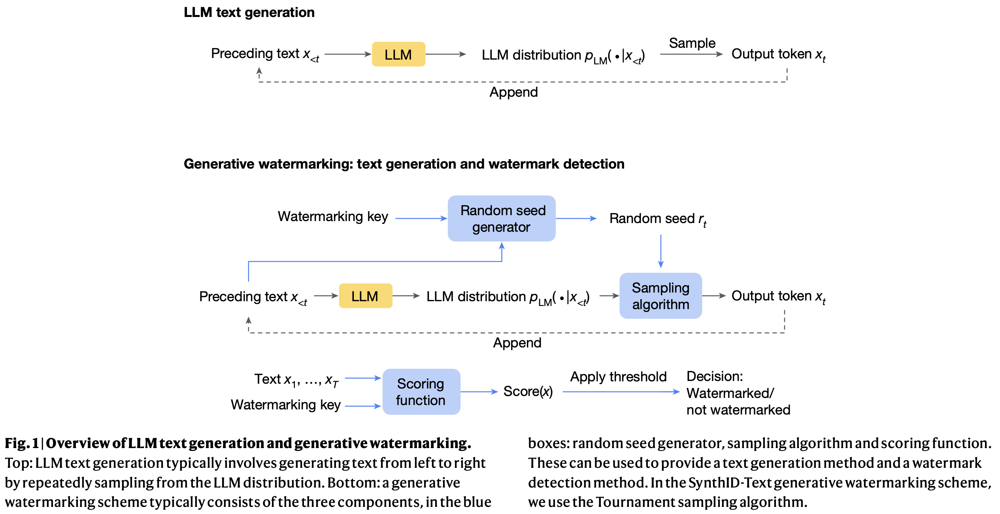

這樣的 generative watermark 又可以分成三個元件：
- random seed generator
- sampling algorithm
- scoring function

figure 1 下半部可以看到，在每一個步驟 $t$ ，random seed generator 會產生一個隨機種子 $r_t$，這個種子可能是根據前面出現的文字 + 一個 key 來產生的。然後 sampling algorithm 會根據 $r_t$ 以及 $P_{LM}(\cdot | x_{<t})$ 來取樣下一個 token。重點就是這個 sampling algorithm 會讓 $r_t$ 和 $x_t$ 產生相關性 (correlations)，這樣輸出的文字就是帶有統計訊號的 watermarked text。

然後這邊採用 sliding window 的方式來取得最近 $H$ 個 token 並與 key 進行 hash 得到 $r_t$。figure 2 上半部可以看到，下面式子則是 $H=4$。不過這邊也不一定要用 sliding window 就是了。到目前為止的 idea 都和 KGW 相同，唯一不同的就是前面提到的 tournament sampling 方法這個等等會提到。

$$r_t = \text{Hash}(x_{t-4}, x_{t-3}, x_{t-2}, x_{t-1}, k),$$

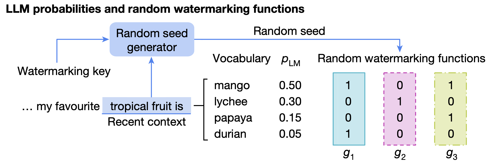

### SynthID-Text’s Tournament sampling approach

所謂的 Tournament 就是讓候選 token 去競賽，這邊會先定義要用到的 watermark function g 的數量 $m$，figure 2 上半部的右邊可以看到有 $m=3$ 個 function $g_1$ $g_2$ $g_3$，彼此是獨立的 pseudorandom number functions (偽隨機函數)。

這個 function g 會給一個 score，公式會像這樣 $g_{l}(x_t, r_t)$，在 figure 2 的例子輸出只有 0 或 1。也就是說同一個 token 在不同的 watermark function 可能會得到不同的輸出。function g 出來的分數我接下來都簡稱為 `g-score`。

在 figure 2 下半部可以看到比賽流程，這邊會先定義 sample 的候選數量 $m$，從 LLM 的輸出機率中 sample $M=2^m$ 個 token 出來，而且同一個 token 可能會被選到多次。像下圖的 $m$ 定義為 3，所以會有八個，不過這邊有四組重複的。$m=3$ 意味著會經過 3 輪比賽，每一輪取分數高者獲勝，如果同分就隨機選一個，最後那個 token 就會是 $x_t$。

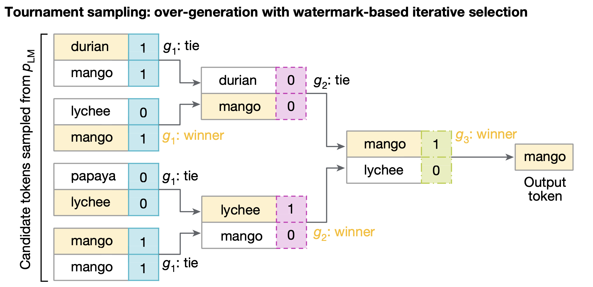

前面作者有提到這套方法可以用在拿不到 LLM 權重的情況，我一開始想說這不還是要拿到機率分佈嗎？後來想到 `openai-python` 套件在呼叫的時候有一個參數 `n` 可以生成多份獨立的完成結果，不過他也不是逐 token 的，所以...不太確定怎麼用在完全黑箱的情況下。誒等等，我想到這個有沒有機會做呀，不過這就類似 [A Watermark for Black-Box Language Models](https://arxiv.org/abs/2410.02099) 提到的，會有很大量的推論成本。

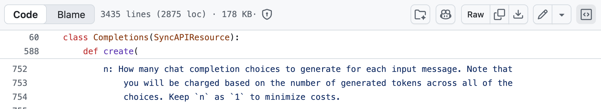

不過到這邊也不難發現 SynthID-Text 和 KGW 最大的差異就是在於不需要修改 logits (可以參考下圖我擷取自 KGW 原始論文 algorithm 2 的第四步驟)，KGW 是直接把修改 logits 後的 LLM 輸出當作有浮水印訊號的文字；SynthID 則是去取樣更多文字，然後 g function 數值高的獲勝 (還要贏每一輪)。KGW 這樣改 logits 的方式是很容易影響文字輸出品質的，而 SynthID 則比較不會，這個後面的章節會提到。

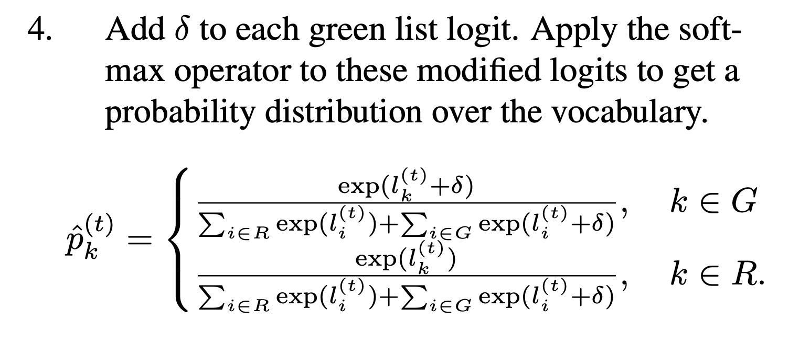

### Watermark detection

偵測方式非常簡單，就是去計算這段可疑文字的 `g-score` 即可，因為文字的採樣偏好 `g-score` 高者，公式如下：
$$\text{Score}(x) = \frac{1}{mT} \sum_{t=1}^{T} \sum_{\ell=1}^{m} g_\ell(x_t, r_t).$$

這邊 m 是 g function 的數量，T 是 token 數量，其實就是把每一輪的每一個 token 的分數加總後平均。如果 Score 異常高，那表示這段文字極有可能是含有 SynthID-Text 的輸出。

有兩種會影響浮水印偵測效能的因素，一個是文字的長度，長度越長偵測就越準；另一個因素則是 entropy，就是輸出下一個 token 的確定程度。如果今天 LLM 分部的 entropy 特低，表示模型每一次 sample 幾乎都會拿到一樣的回覆。直覺想一個例子就是我告訴 ChatGPT 給我生成 100 個 a 好了，那他怎麼可能給我生成 b，這 100 個 a 要怎麼去加浮水印？反之，如果要他生成一篇小說，那可能性就非常多樣且長度也很長。這和其他浮水印方法遇到的問題可以說是一模一樣。

作者提到，LLM 分佈的 entropy 大小有很多因素會影響，越大的模型對自己的輸出就越有自信所以 entropy 會越低，如果有經過 RLHF 也可能降低 entropy，此現象又稱為 mode collapse (在 GAN model 常常用到的詞)，還有前面我提的例子的 prompt 也是、temparature 也是，還有很多。

如果增加 Tournament layer m 的數量，可以讓每一個 token 提供更多 watermark evidence，同時降低 Score 公式的變異數。不過偵測的能力也不會隨著 layer 提升而無限增加 (直覺理解就是你後面的 layer 能選的多樣性也不多了，已經被前面選過多次了)

本篇論文測試的 $m$ 如果沒有特別講都設定成 $30$。

### Preserving the quality of generative text

這邊要提到一個詞叫「non-distortionary」，在過去的文獻這個詞有點混淆了，作者把所謂讓文字失真這件事定義成幾種不同的程度，從最弱到最強去分。其中最弱的就是 single-token non-distortionary。定義是當我們對 random seed $r_t$ 取平均時，由 watermark sampling algorithm 採樣的分佈，要等於從 $P_{LM}(\cdot|x_{<t})$ 取樣的分佈。

我一開始有點看不懂但我仔細想想他要怎麼驗證這件事就通了，其實就是去產生各種不同的 $r_t$ 然後把經由這些 $r_t$ 的 sampling algorithm 產生的文字去取平均就知道了。

更強的 non-distortionary 定義就會擴展到更長的 token 而不是 single-token 而已，可能是整個序列之類的。就是從 $P(x_t)$ 到要求 $P(x_1, x_2, ..., x_t)$ 都要保證和 LLM 的分佈相同。(這點其實就是 [A Watermark for Black-Box Language Models](https://arxiv.org/abs/2410.02099) 提到的 distortion-free 的概念)

至於 SynthID-Text 為什麼可以做到 single-token non-distortionary，在 Supplementary Information Section G.1 有證明，當競賽的候選只有兩個的情況，那就有 single-token non-distortionary 的性質。如果大於兩個那就不可能會 non-distortionary。

#### 大於 2 不可能 non-distortionary 的證明如下：

假設 LLM 在只有兩個 token 的 vocabulary $V=\{a,b\}$ 中抽樣 $N$ 次，$a$ 產生的機率為 $p$，$b$ 產生的機率為 $1-p$。在 $N$ 次抽樣中，$a$ 出現的次數 $i$ 符合二項式分佈 $Binomial(N,p)$。我們要算的是 $a$ 最後被選為 $x_t$ 的機率 $p_{wm}(a)$，對 $r$ 取期望後希望它等於 $p$。

考慮三種情況
- a 被選中 0 次，也就是 $(1-p)^N \times 0=0$。
- a 被選中 N 次，也就是 $p^N\times 1=p^N$。
- a 和 b 都有被選中，就是後面這個二項式分佈的式子，後面就是 g function 的數值，如果平手的話就直接是 $\frac{i}{N}$ 因為隨機挑。

**對 r 取期望值**，因為 $p^N$ 和二項式分佈那坨都和 r 沒關係所以可以取出來，等於說是取後面這項的期望值。這邊 $C_{f_g}$ 是 Collision probability (碰撞機率或者說平手機率) 的意思，利用指示函數 (Indicator function) 對指示函數取期望值，結果正好等於該事件發生的機率，而 $\frac{1-C_{f_g}}{2}$ 就是這樣來的，1 扣掉 $C_{f_g}$ 後剩下的就是 $P(g_1(a) > g_1(b))+P(g_1(a) < g_1(b))$ 的機率，而雜湊函數的設計就是讓他是公平的，所以這邊可以直接除以二。
$$\begin{aligned}
\mathbb{E}_r \left[ p_{\mathrm{wm}}(a \mid p_{\mathrm{LM}}, r, f_g, N, 1) \right] 
&= \mathbb{E}_r \left[ p^N + \sum_{i=1}^{N-1} \binom{N}{i} p^i (1-p)^{N-i} \left[ \mathbb{1}_{g_1(a, r) > g_1(b, r)} + \mathbb{1}_{g_1(a, r) = g_1(b, r)} \frac{i}{N} \right] \right] \\
&= p^N + \sum_{i=1}^{N-1} \binom{N}{i} p^i (1-p)^{N-i} \left[ \frac{1 - C_{f_g}}{2} + C_{f_g} \frac{i}{N} \right]
\end{aligned}$$
這個期望值的式子展開後會長得像 $c_0\cdot p^0 + c_1\cdot p^1 + ...c_N \cdot p^N$ ，而這個東東要恆等 (Identically Equal，在所有可能的變數取值下都成立) 於 $p$ (就是 $1\cdot p^1$)，才符合 non-distortionary 的期待。也就是說要成立的話，因為 Polynomial Identity Theorem (多項式恆等定理) 的關係，$c_1$ 必須為 1，其他係數都要是 0。只要找出其他係數非 0 那就矛盾

$p^2$ 係數的展開與計算，這邊 $N>2$ 且 $C_{f_g} \neq 1$ 所以會是非 0，矛盾了。

$$\begin{aligned} &\sum_{i=1}^{2} \binom{N}{i} \binom{N-i}{2-i} (-1)^{2-i} \left[ \frac{1 - C_{f_g}}{2} + C_{f_g} \frac{i}{N} \right] \\ &= - N(N-1) \left[ \frac{1 - C_{f_g}}{2} + C_{f_g} \frac{1}{N} \right] + \frac{N(N-1)}{2} \left[ \frac{1 - C_{f_g}}{2} + C_{f_g} \frac{2}{N} \right] \\ &= \frac{N(N-1)}{4} \left[ C_{f_g} - 1 \right] \end{aligned}$$

#### 當一層是兩個樣本去競賽時必定 non-distortionary 的證明如下：

這個是 single layer ($m=1$) $p_{wm}$ 的定義，分子是「在 $N$ 次抽樣中，每一個樣本的分數都小於或等於 $x_t$ 的機率」減去「在 $N$ 次抽樣中，每一個樣本的分數都嚴格小於 $x_t$ 的機率（代表最高分比 $x_t$ 還低）。」，兩者相減就是最高分數正好等於 $g_1(x_t, r)$ 的機率。分母則是所有和 $x_t$ 同 g-value 的 token 的機率總和 (包含 $x_t$ 自己)。

$$p_{wm}(x_t \mid p, r, f_g, N, 1) = \begin{cases}
p(x_t) \left( \frac{p(V \le g_1(x_t, r))^N - p(V < g_1(x_t, r))^N}{p(V = g_1(x_t, r))} \right) & \text{if } p(x_t) \neq 0 \\
0 & \text{if } p(x_t) = 0.
\end{cases}$$
也可以想成下式：

$$p_{\mathrm{wm}}(x_t) = \underbrace{\left[ p\left(V^{\le g_1(x_t,r)}\right)^N - p\left(V^{< g_1(x_t,r)}\right)^N \right]}_{\text{最高分恰好等於 } g_1(x_t, r) \text{ 的機率}} \times \underbrace{\frac{p(x_t)}{p\left(V^{= g_1(x_t,r)}\right)}}_{\text{在平手群體中，} x_t \text{ 贏得選取的機率}}$$

將 $N=2$ 帶入後可以寫成以下，就是按照原始 LLM 的機率分佈去乘以「Vocabulary 中分數和 $x_t$ 剛好相同的機率」+「Vocabulary 中分數大於或小於的機率」，這邊之所以可以直接 $2p(V^{g_1(x_t,r)})$ ，這個 2 倍純粹來自代數：$\le$ 可以拆成 $<$ 和 $=$，所以 $A+B = (B + p(V^{=})) + B$ 會多出一倍的 $p(V^{<g_1(x_t,r)})$，這一步還沒用到雜湊函數的性質。機率可以變成指示函數的加總所以有了最後的式子。

平方差公式：
$$ A^2 - B^2 = (A - B)(A + B) $$

然後 "$\le$" 可以拆成 "$<$" 和 "$=$", $A = B + p\left(V^{= g_1(x_t, r)}\right)$：
$$ A - B = p\left(V^{= g_1(x_t, r)}\right), \quad A + B = p\left(V^{= g_1(x_t, r)}\right) + 2p\left(V^{< g_1(x_t, r)}\right) $$

帶回去消掉：
$$ p_{\text{wm}}(x_t) = \underbrace{(A - B)}_{p\left(V^{= g_1}\right)} (A + B) \times \frac{p(x_t)}{\underbrace{p\left(V^{= g_1(x_t, r)}\right)}_{\text{cancels}}} = p(x_t) \left[ p\left(V^{= g_1}\right) + 2p\left(V^{< g_1}\right) \right] $$

機率就可以寫成，並還原為 indicator function 的加總：
$$\begin{aligned}
p_{\mathrm{wm}}(x_t \mid p, r, f_g, 2, 1) 
&= p(x_t) \left( p(V^{= g_1(x_t, r)}) + 2 p(V^{< g_1(x_t, r)}) \right) \quad  \\
&= p(x_t) \left( \sum_{x \in V} p(x) \left[ \mathbb{1}_{g_1(x, r) = g_1(x_t, r)} + 2 \mathbb{1}_{g_1(x, r) < g_1(x_t, r)} \right] \right) \quad 
\end{aligned}$$
然後我們要對 r 取期望值 $\mathbb{E}_r[p_{wm}]$，也就只要算下面這個，可以發現這邊有用到雜湊函數的性質，也就是把 $2\mathbb{E}[\mathbb{1}_<]$ 拆成 $\mathbb{E}[\mathbb{1}_<] + \mathbb{E}[\mathbb{1}_>]$：
$$\begin{aligned}
&\mathbb{E}_r \left[ \mathbb{1}_{g_1(x, r) = g_1(x_t, r)} \right] + 2 \mathbb{E}_r \left[ \mathbb{1}_{g_1(x, r) < g_1(x_t, r)} \right] \\
&= \mathbb{E}_r \left[ \mathbb{1}_{g_1(x, r) = g_1(x_t, r)} \right] + \mathbb{E}_r \left[ \mathbb{1}_{g_1(x, r) < g_1(x_t, r)} \right] + \mathbb{E}_r \left[ \mathbb{1}_{g_1(x, r) > g_1(x_t, r)} \right] \quad \text{(by Methods Def 4)} \\
&= \mathbb{E}_r \left[ \mathbb{1}_{g_1(x, r) = g_1(x_t, r)} + \mathbb{1}_{g_1(x, r) < g_1(x_t, r)} + \mathbb{1}_{g_1(x, r) > g_1(x_t, r)} \right] \\
&= \mathbb{E}_r [1] \\
&= 1.
\end{aligned}$$

帶回去，得到了。(multi-layer 也有證明出一樣的結果)
$$\begin{aligned}
\mathbb{E}_r \left[ p_{\mathrm{wm}}(x_t \mid p, r, f_g, 2, 1) \right] 
&= p(x_t) \left( \sum_{x \in V} p(x) \right) \\
&= p(x_t).
\end{aligned}$$

然後 Section G.2 又有詳細描述透過 repeated context masking 的方式來達到 non-distortionary for one or more sequences 性質的證明。就是去避免同一個 context 再次出現時，又套用相同的 watermark bias。這個就留給大家自己去看吧，反正我是相信他了，絕對不是懶得看了。

這篇文章的 Supplementary Information 根本在寫課本了，從基本的開始講，蠻值得一看，但我有點累了。
### Ensuring computational scalability

因為只要在 sampling layer 做一些改動，所以不會重新執行 LLM 本身，因此附帶的計算成本可以忽略。且這些候選 token 的 g-value 可以平行運算，很適合 vectorization。

要注意一點就是 production system 通常不是一般的 autoregressive loop，像是 production 可能會利用 speculative sampling 的方式，就是一種利用一個更小更快的 model 去預測 token 讓 LLM 可以更快運算的方法。target LLM 會再去檢查這些預測的 Token，就不用 Target LLM 每次都要浪費時間 forward，多出來的這些預測 token 可以平行運算。

以下是 speculative sampling 的演算法，這邊 q 是 target LLM，p 是小模型
1. 4 ~ 6 行，先讓小模型 draft K 個候選 token
2. 7 行，大模型把這 K 個 token 一起輸入，就可以平行運算 logits
3. 8 ~ 15 行，檢查的步驟，對每一個 drafted token $\tilde{x_t}$ 抽取隨機均勻數 $r \sim U[0,1]$ ，如果 $r < min(1, \frac{q(\tilde{x_t})}{p(\tilde{x_t})})$ 就把小模型 q 的 token 納入最後結果。如果不符合就立刻中斷本輪驗證，然後從殘差分佈中重新抽樣正確的 token 替換

這邊值得注意的是 reject 的情況，就是要避免被拒絕的那個 token 變高，所以才要用這個式子，把兩個機率分佈相減。還有他們比較的方式，是用 target model 機率除以小 LLM 機率，越接近 1 甚至 > 1 就越有可能被接受，所以就是比較大模型和小模型對這個 token 的認同度的概念。然這邊也利用了 Uniform，因為小魔型的機率乘以這個 accept rate 的機率剛好就會是 target LLM 的機率，這麼做才不會讓 sampling 的分佈和 target LLM 不同，才不會影響生成品質，這樣才公平。
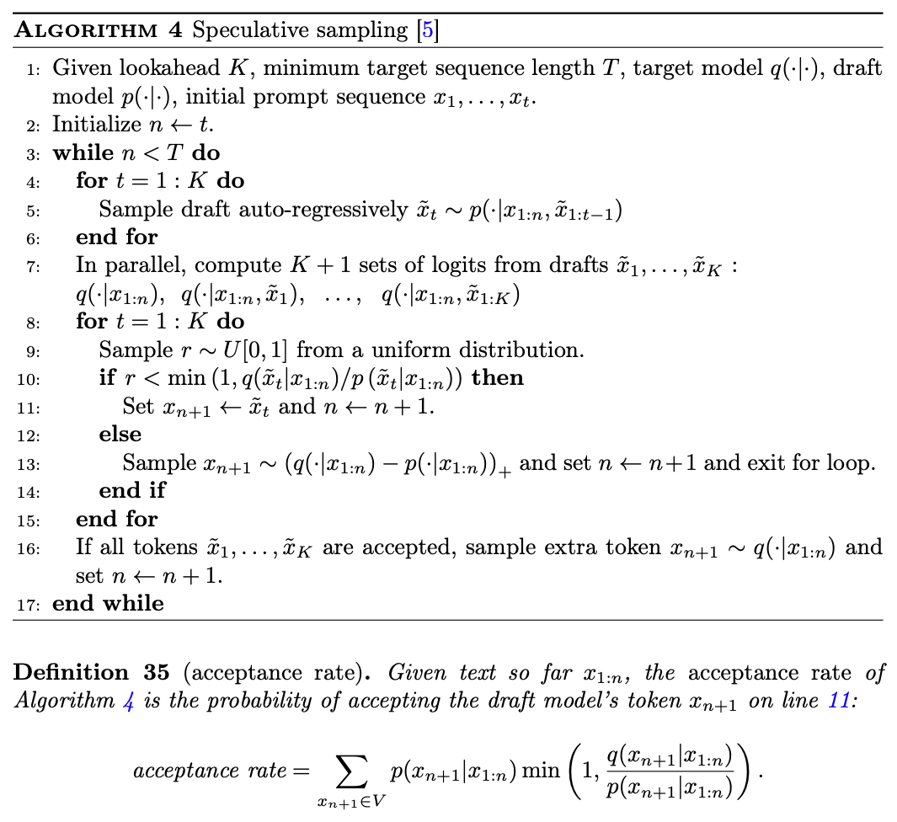

這邊右下角的 + 符號表示「Positive Part Operator / Rectified Unit」，效果就和 ReLU + L1 normalization 相同

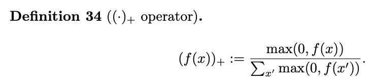

在這之前還沒有人討論過怎麼把 generative watermarking 與 speculative sampling 結合，這是他的貢獻之一。這邊作者提出了兩種 generative watermarking scheme with speculative sampling 演算法，在 supplementary Information Section I.4：

#### high-detectability watermarked speculative sampling

目標是維持 watermark 的可偵測性，可能會降低 speculative sampling 的效率但是不會犧牲浮水印的訊號。這邊演算法 (algorithm5) 就不特別說明了，和 speculative sampling 的方法一樣，只是 target LLM 的機率分佈換成 watermark sampling function 的機率分佈而已。不過會增加成本，因為演算法要求直接算出 $p_{wm}$ 以及 $q_{wm}$ 的分佈。主要是慢在 reject 的機率高，被 reject 後還要算整個 Vocabulary 的 watermark 分佈。

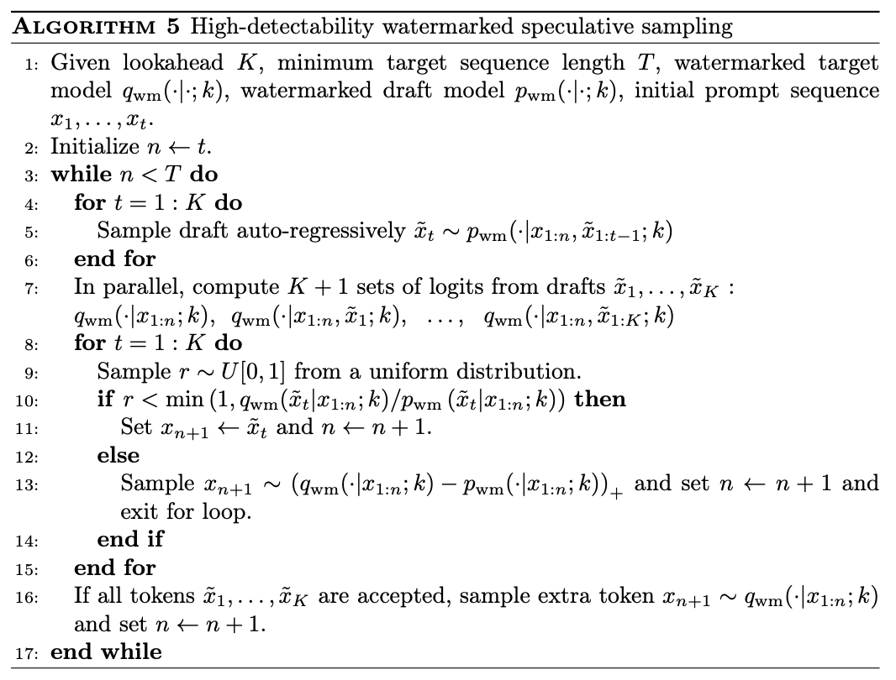
#### fast watermarked speculative sampling

可以維持 speculative sampling 的效率，但是可偵測性可能下降。針對這個 approach 作者提出了 learned bayesian scoring function，讓偵測端更有效。

以下演算法可以看到，他不需要算出 $p_{wm}$ $q_{wm}$ 之類的機率，只要能夠 sample 就好。然後還有雙金鑰的機制，Draft key $k^D$ 是小模型用的，Target Key $k^T$ 是大模型用的。
1. 4 ~ 6 行，一樣讓小模型產生 K 的 draft token，產生這些 token 時小模型用的是 $k^D$。
2. 然後大模型開始跑平行運算，算出這 K 個位置未加浮水印的分佈
3. 然後用跟前面提到一樣的方式去檢查 draft token
	1. 有通過的話，那就是 accept，不過注意這個 token 保留的是小模型的 key 的 watermark
	2. 沒通過的話，這時候大模型會用 $k^T$ 從分佈抽一個 token 補上，然後中斷這回合

之所以可以說他是 fast 是因為 algorithm 5 的 10 行比值是 $\frac{q_{wm}(\tilde{x_t})}{p_{wm}(\tilde{x_t})}$ 也就是說系統要把這幾萬個 token 都丟回 watermark sampling function 算一遍，但是 algorithm 6 第十行只要算 $\frac{q(\tilde{x_t})}{p(\tilde{x_t})}$ 就可以了。和完全沒有浮水印的原始 speculative sampling 一樣快。之所以要用 two key 也是考慮到機率獨立性的問題 ($k^D$ 和 $k^T$ 互相獨立抽樣)，這樣可以提升 target model 接受 draft model 的 token 機率，因為理論上 p 和 q 會很像，two key 等於說消除了 watermark 的干擾。

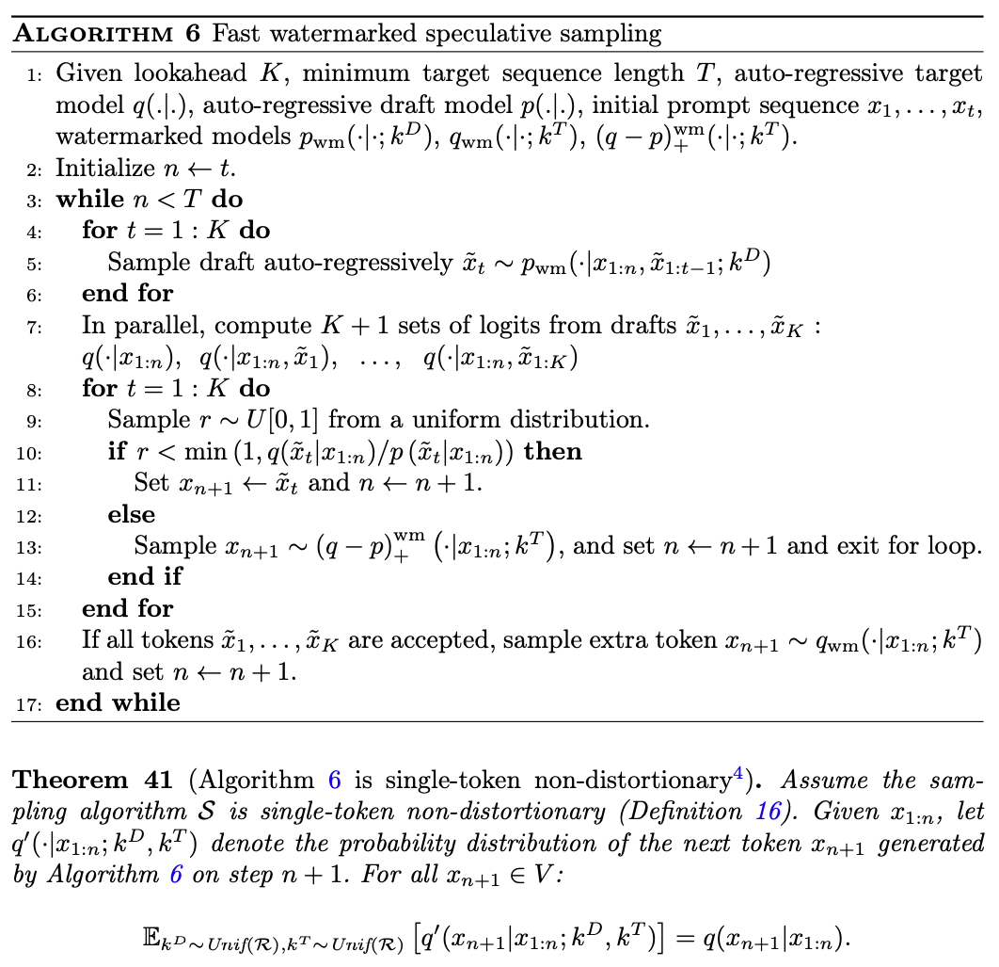

## Evaluation

作者做了很多實驗，這邊只挑有趣的講。

作者比較對象分為兩種，non-distortionary 和 distortionary，前者選擇當時最佳的 Gumbel sampling 後者則選擇 Soft Red List。為了公平比較 (like-for-like comparison)，作者把焦點放在 sampling algorithm 上，其他部分都維持相同 (像是 random seed generator、scoring 之類的)，對所有 baseline 作者使用相同的 sliding window random seed generator，以及相同的 repeated context masking。

希望驗證 quality (不能影響文字品質) 和 scalability (不能 cost 太高)

### SynthID-Text preserves quality including in a large-scale- production system

在 gemini 還叫做 bard 的時候，他們就做了線上的測試，把 user query 一半丟給 watermarked sampling 一半丟給沒有 watermark 的，讓使用者透過 UI 上的 👍 和 👎 來評分。結果就是 thumbs-up rate 說差 0.01 (thumbs-down 則是差 0.02)，而且有 2000 萬筆喔，等於說幾乎沒差的意思，至少人類感覺不出來。

為了提供其他人可以 reproduce 的實驗，作者用 Gemma 7B-IT (IT -> instruction-tuned) 對 300 個 ELI5 (explain like im five 取名來自知名的 Reddit 論壇，有很多複雜且開放式的大哉問) 問題來回答，然後一樣讓人類評分，以 side-by-side comparison 的方式 (應該就是 LM-SYS 那種)，對以下面向進行評分
- grammaticality / coherence：文法與連貫性
- relevance：相關性
- correctness：正確性
- helpfulness：實用性／幫助程度
- overall quality：整體品質

果就是沒有統計上的差異，可以看到 Extended Data Table 1

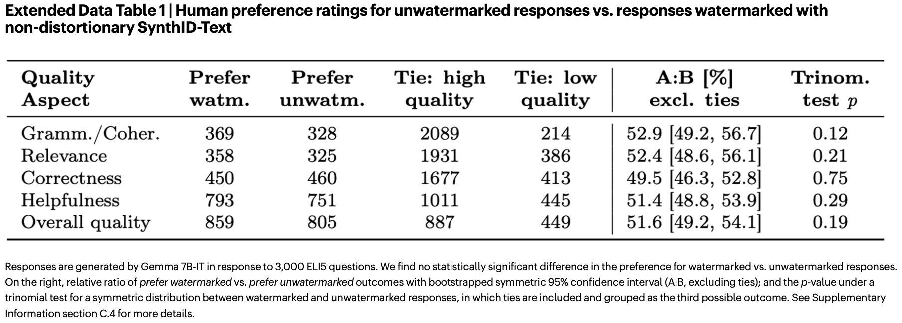

然後他還有做 perplexity 和 automated benchmark performance，結論就是 non-distortionary SynthID-Text 與 unwatermarked model 都沒有顯著差異。
### SynthID-Text provides better detectability than existing watermarks

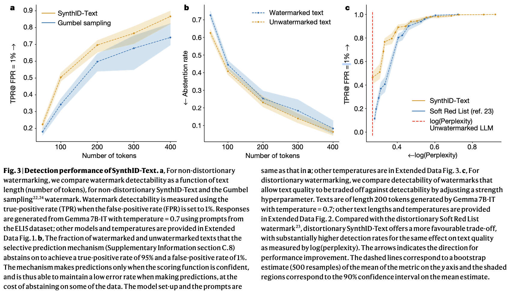
model:
- Gemma 2B-IT
- Gemma 7B-IT
- Mistral 7B-IT
實驗採用 ELI5 資料集，都是一些需要具有解釋性的多句回答，我在想他們的目的是這樣的 prompt 會使輸出 entropy 高的意思。在 figure 3a 是 non-distortionary 的類別，可以看到 SynthID-Text 確實比 Gumbel sampling 的效果好，且可以看到 token 越長確實 TPR 就越高。注意這邊的縱軸是 $TPR\ @\ FPR = 1\%$ 也就是在 FPR 最多只能 1% 的情條件下，模型的 TPR 是多少 (可以想成 score 的門檻)。

如果是在需要非常低 FPR 的場景，可以用 selective prediction mechanism 的方式，就是對那些 scoring function 沒有信心的 sample 直接不做判斷 (abstention)。系統會設定兩個分數門檻
- 高門檻 $\tau_{positive}$：根據 unwatermarked text 算出來，高於這個門檻才敢判斷為有 watermark (控制 FPR)
- 低門檻 $\tau_{negative}$：根據 watermarked text 算出來，低於這個門檻才敢判斷為無 watermark (控制 FNR)
如果 $\tau_{positive} < \tau_{negative}$ 表示目前長度的檢測能力非常好，完全不需要棄權就可以完成要求。

figure 3b 就是在描述採用 selective prediction mechanism 的情況，縱軸是放棄率，可以看到 token 越多，detector 越不會放棄。

figure 3c，低 perplexity 和高 TPR 的搭配在左上角，越靠近左上角越好。可以看到 SynthID-Text 與 Soft Red list 的方法相比，模型困惑度更低，表示句子的品質犧牲較少。

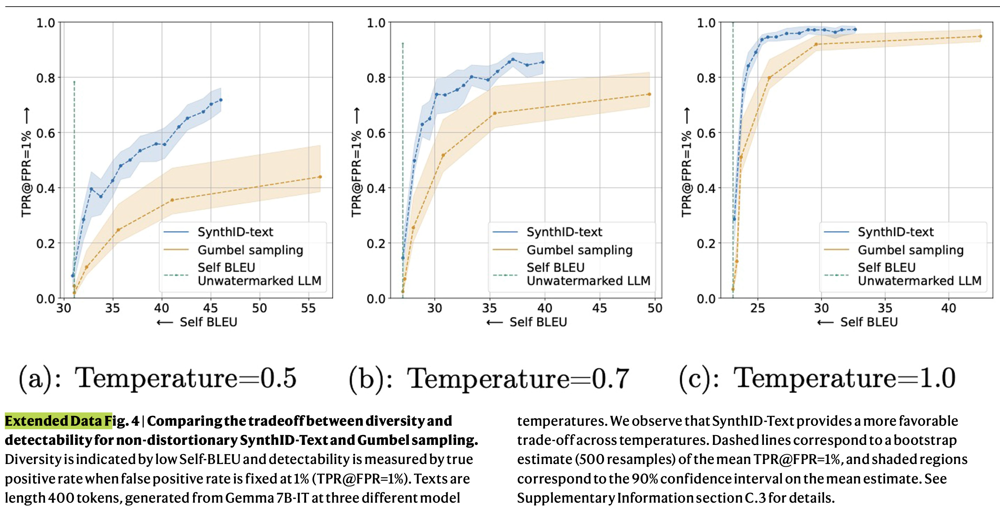

Extended data fig 4，這邊用的是一個叫 Self-BLUE 的指標，用來衡量文字的多樣性，數值越低表示 diversity 越高。可以看到 SynthID-Text 也是比 Gumbel sampling 的多樣性更高

### SynthID-Text has minimal computational impact

作者指出，Tournament sampling 花費的時間確實可能比 Gumbel 和 Soft Red List sampling 還要久，但是這些時間都還是遠小於 LLM 本身推論的時間，所以對系統整體的影響相較是比較小的。

這邊作者做了一個實驗是當 Gemma 7B-IT 使用 4 個 v5e TPU 時，原始文字生成速度為 15.527 ms / token，加入 30-layer tournament sampling 後，時間來到 15.615 ms / token。latency 只多了 0.57%。作為比較，Gumbel 增加的 latency 為 0.26%，Soft Red List 則增加 0.28%。可以看到根本就沒什麼差。

## Discussion

### Contribution

以下是我整理的 Contribution
- We have introduced SynthID-Text, a method for watermarking LLM text.
- SynthID-Text uses certain elements introduced in previous work, but differs in the use of the sampling algorithm, Tournament sampling, which we find provides superior detectability compared with existing methods. 採用了過去研究的部分元素，但多了一個創新 sampling 方法：tournament sampling，這樣的方法優於現有方法的檢測能力。
- SynthID-Text comes with rigorous and customizable non-distortion properties that can be configured to guarantee text quality preservation. SynthID-Text 具有可以客製化的 non-distortionary 特性 (兩個面向，一個是 tournament 每一場有幾個 competitors，如果剛好只有兩個那就是 single-token non-distortionary；另一個面向是 repeated context masking 的 K 值)，可以確保文字品質不受影響
- We have also proposed an algorithm to combine generative watermarking with speculative sampling. 提出 generative watermarking 與 speculative sampling 結合的演算法

### Limitations

這種 generative watermark 的優點是跨語言穩定性高，且比 post hoc detector 還要好 (因為不會有遇到沒看過的資料的問題)。比較顯著的限制：
- 需要服務提供商配合，如果不配合的話，那可能要搭配 post hoc detector 來檢驗。也就是說 SynthID-Text 也不是萬能解。
- 開源模型通常是去中心化的方式部署，官方無法強制每一個人都帶有浮水印的機制去推論
- 浮水印還是可能被竊取 (stealing，透過觀察大量 watermarked output 去推出 watermark 規則)、偽造 (Spoofing)、抹掉 (Scrubbing)
- 改寫攻擊 (LLM paraphrasing)：用其他 LLM 來改寫具有浮水印的文字，其實很容易就把 watermark 訊號移除了。

啊我還有想到一個，對我們這樣的 LLM 應用開發者來說，其實我們也拿不到 sampling 的東東，應該說我們也沒辦法對 sampling 的過程做到如 SynthID-Text 這麼細節的操作。所以黑箱 API 的浮水印也是一個值得挑戰的問題。

### Conclusion

這篇論文為 SynthID-Text 提供了證據證明 SynthID-Text 在真實世界是有可行性的，據他們所知，這是第一個大規模部署的 Generative text watermark。(但應該也只有 Google 可以做到這種程度XD)

